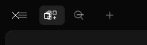
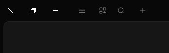

# opencode-fix-topbar

Fixes overlapping window buttons in OpenCode Desktop on right-to-left Windows.

| Before | After |
| --- | --- |
|  |  |
| The close button covers the menu | The menu is clear and clickable |

## The problem

On RTL Windows, the window buttons (minimize, maximize, close) are on the left. The app expects them on the right, so
its menu buttons are drawn under them and can't be clicked.

## The fix

The plugin moves the titlebar over by the width of those window buttons.

```css
header[data-slot="titlebar-v2"] {
  margin-left: env(titlebar-area-x, 0px);
}
```

## Install

1. Put this folder anywhere on your computer.
2. Add its path to the `plugins` list in your global `opencode.jsonc`
   (`~/.config/opencode/opencode.jsonc`):

   ```jsonc
   {
     "plugins": ["C:/path/to/opencode-fix-topbar"]
   }
   ```

3. Restart OpenCode Desktop.
4. If it doesn't show up, check **Settings → Extensions → Plugins**.

The built plugin is included in `dist/`, so no build step is needed.

## Change the code

```bash
npm install
npm run dev   # rebuilds and reloads the plugin on every save
```

## If it still overlaps

Force the offset in `opencode.jsonc`:

```jsonc
{
  "plugins": [
    { "package": "C:/path/to/opencode-fix-topbar", "options": { "inset": 138 } }
  ]
}
```

Set `"inset": 0` to turn the fix off.

## Notes

- Windows only. macOS already handles its own window buttons.
- Unofficial plugin. Not affiliated with or endorsed by OpenCode.
- MIT licensed.
